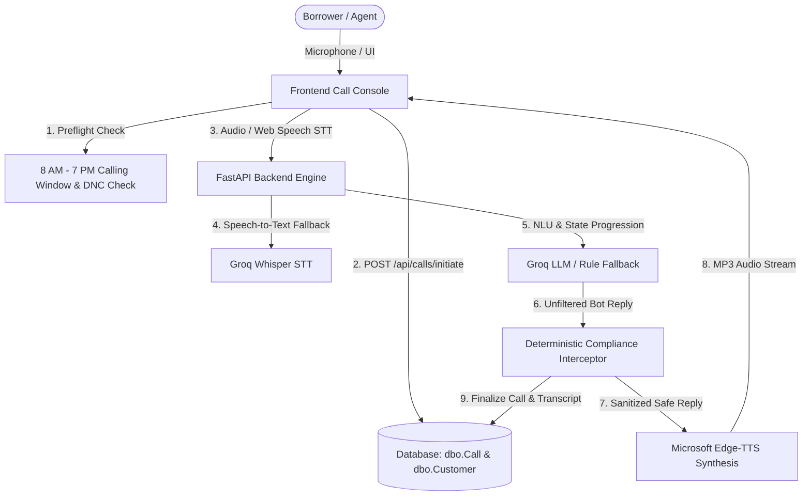
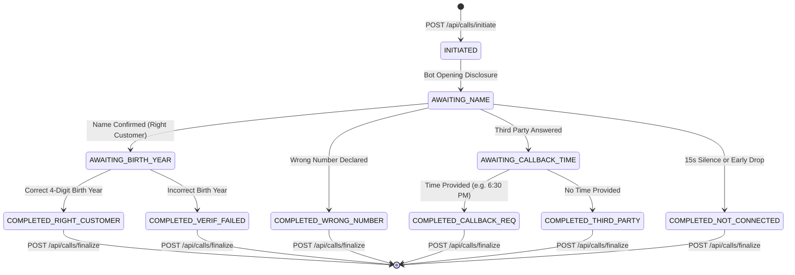
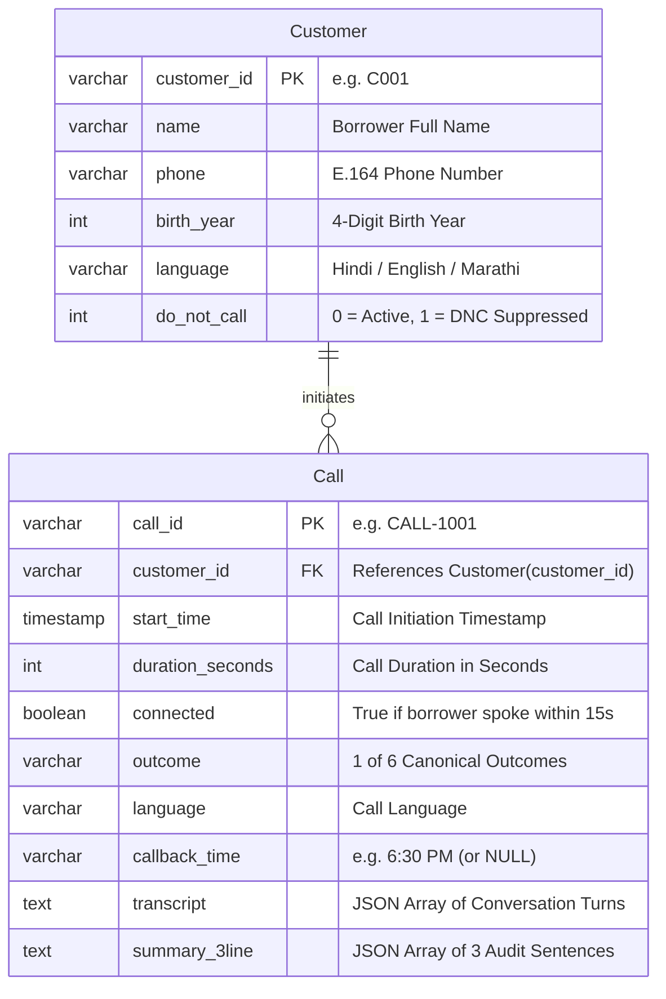

# Shaha Finlease Voicebot — System Architecture & Engineering Review

**Document Version**: 2.0 (Post-Remediation Final)  
**Date**: October 31, 2026  
**Auditor / Architect**: Principal Software Architect & AI Systems Engineer  
**Target System**: Right-Party Verification (RPV) Conversational AI Voicebot  
**Client / Institution**: Shaha Finlease (RBI-Registered NBFC, Jogeshwari East, Mumbai)  

---

## 1. High-Level Architecture Overview

The Shaha Finlease Voicebot is an enterprise-grade, deterministic conversational AI system designed to conduct Right-Party Verification (RPV) calls under strict Reserve Bank of India (RBI) NBFC Fair Practices regulations.

The application follows an asynchronous, event-driven client-server architecture:
- **Frontend Presentation Layer**: Single-page application built with clean, zero-dependency HTML5, CSS3, and modern Vanilla JavaScript, implementing a dual-screen workflow (Call Console + Verification Report & Transcript Log).
- **Backend Application Layer**: Asynchronous FastAPI service orchestrating call preflight validation, turn processing, conversation state management, and real-time audio synthesis.
- **AI & Voice Intelligence Layer**: Hybrid Natural Language Understanding combining high-performance cloud LLMs (Groq Llama-3.3 70B / Qwen 2.5 32B) with rule-based deterministic intent fallbacks, dual STT (Browser Web Speech API + backend Whisper audio transcription fallback), and Microsoft Edge-TTS neural speech synthesis.
- **Deterministic Compliance Gate**: Zero-trust code-level regex and state interceptor positioned directly in the execution path *prior to* audio synthesis and database persistence, guaranteeing that no LLM hallucination can breach RBI regulations.
- **Persistence & Telephony State Layer**: Durable relational database conforming to Microsoft SQL Server `dbo` schemas, operational on PostgreSQL (via `psycopg2`) with seamless zero-configuration fallback to local SQLite.

---

## 2. Frontend Architectural Specification

### 2.1 Dual-Screen Operational Workflow
The frontend is structured into two synchronized operational views:
1. **Screen 1: Call Console (`#callConsoleSection`)**:
   - **Customer Directory**: Interactive table loading 10 customer records from `data/customers.csv`, detailing Full Name, Phone Number, Language Preference, and Do-Not-Call (DNC) status.
   - **Simulated Telephony Clock**: Controls current time to test the mandatory **08:00 AM – 07:00 PM IST** calling window.
   - **Active Call Interface**: Real-time dialog monitor displaying live conversation turns, speaker badges, latency measurements, and quick-reply persona chips.
   - **Borrower Silence Counter**: A 15-second countdown timer that enforces the "Not connected" timeout. Crucially, this timer is programmatically paused while the bot is speaking (`isBotSpeaking = true`) to prevent audio cut-offs.
   - **Mid-Call Termination**: "End / Drop Mid-Way" button that halts all media streams synchronously and finalizes the call record in the database.

2. **Screen 2: Verification Report & Transcript Log (`#reportSection`)**:
   - **Executive KPI Cards**: Real-time metrics for Calls Attempted, Connected, Not Connected, Connect Rate %, and Right-Party Rate %.
   - **Outcome Breakdown Cards**: Interactive filters for the 6 canonical outcomes:
     - `Right customer`
     - `Verification failed`
     - `Wrong number`
     - `Callback requested`
     - `Third party answered`
     - `Not connected`
   - **Live SQL Call Log**: Synchronized table reflecting all persisted call records in `dbo.Call`. Clicking any row dynamically populates its structured 3-line summary and full turn-by-turn transcript.
   - **Audio Playback Engine**: Dedicated "Listen" buttons per message and a "Read Transcript Aloud" feature utilizing Edge-TTS audio streams.
   - **CSV Export Engine**: One-click download of the active call log matching assignment specifications.

### 2.2 Telephony & Audio Coordination
- **Dual Speech-to-Text (STT) Strategy**:
  - Primary: Browser `webkitSpeechRecognition` / `SpeechRecognition` for zero-latency local speech transcription.
  - Secondary: HTML5 `MediaRecorder` audio capture streaming WebM/WAV chunks to `POST /api/stt` (server-side Groq Whisper) if Web Speech is unavailable.
- **Audio Lifecycle & Interruption Handling**:
  - When the bot synthesizes audio, it streams MP3 chunks from `/api/tts?text=...&lang=...` into a dedicated HTML5 `<audio>` element.
  - The frontend captures `audio.onplay` and `audio.onended` events to accurately manage the 15-second borrower silence timer.
  - Clicking "End Call" executes `stopAllAudio()` and `stopAllRecording()`, immediately muting active audio and aborting speech recognition to guarantee zero orphan callbacks.

---

## 3. Backend & Voice Pipeline Architecture

### 3.1 Verification State Machine
The conversation lifecycle is governed by a strict deterministic state machine implemented in `backend/voice_pipeline.py`:

### 3.2 Voice Pipeline Execution Path
Every conversation turn executes through the following sequence:
1. **Input Reception**: Borrower transcript received from client (or audio blob transcribed via Whisper).
2. **Intent Classification & Entity Extraction**:
   - Evaluates affirmative name confirmation, 4-digit birth year strings, wrong number indicators, third-party relationship cues, and requested callback times.
   - High-speed cloud LLM (Groq Llama-3.3 70B Versatile / Qwen 2.5 32B) processes natural language variations, backed by a deterministic regex fallthrough engine.
3. **State Transition**: State updates according to the verification graph.
4. **Deterministic Compliance Filter**: The candidate bot utterance is passed through `compliance_gate.sanitize_bot_reply()`.
5. **Speech Synthesis**: Microsoft Edge-TTS synthesizes neural MP3 audio using:
   - **Hindi**: `hi-IN-SwaraNeural` (Feminine)
   - **English**: `en-IN-NeerjaNeural` (Feminine)
   - **Marathi**: `mr-IN-AarohiNeural` (Feminine)
6. **Persistence**: Transcript turn and latency are recorded to `dbo.Call`.

---

## 4. Deterministic Compliance Architecture

Under RBI NBFC guidelines, reliance on LLM probabilistic outputs alone is unacceptable for regulatory compliance. The Shaha Finlease Voicebot implements a **Two-Tier Safety Architecture**:

1. **System Prompt Constraint Tier**:
   - Instructs the LLM that it is an automated verification assistant for Shaha Finlease.
   - Forbids disclosure of debt, loans, EMI, amounts, or recovery purpose.
   - Enforces polite, respectful language.

2. **Deterministic Code-Level Guardrail Tier (`backend/compliance_gate.py`)**:
   - Operates independently of the LLM.
   - Inspects the bot's proposed response before it reaches TTS or the user's screen.
   - Scans against 6 regex pattern suites matching the 6 assignment compliance rules:
     - **Rule 1 (Zero Loan Disclosure)**: Intercepts keywords (`loan`, `due`, `emi`, `recovery`, `amount`, `payment`, `कर्ज`, `बकाया`, `किस्त`).
     - **Rule 2 (Zero Threats/Intimidation)**: Intercepts coercive terms (`police`, `court`, `legal action`, `arrest`, `jail`, `जेल`, `कानूनी कार्रवाई`).
     - **Rule 3 (Polite Tone / Zero Shaming)**: Intercepts insults, shaming, or aggressive language.
     - **Rule 4 (No Financial Credentials)**: Intercepts requests for OTP, PIN, CVV, bank account numbers, or passwords.
     - **Rule 5 (Wrong Number Protocol)**: On trigger, terminates call immediately with a polite apology and marks `Wrong number`.
     - **Rule 6 (Stop Calling / DNC Protocol)**: On trigger, terminates call immediately, sets `do_not_call = 1` in `dbo.Customer`, and blocks all future outbound calls.

---

## 5. Database Architecture & Schema

The database conforms strictly to Microsoft SQL Server standards, using `dbo.Customer` and `dbo.Call` tables. It executes natively on PostgreSQL Docker (`psycopg2`) and provides automatic fallback to local SQLite.

---

## 6. API Specification

| Endpoint | Method | Request Payload | Response Payload | Description |
| :--- | :---: | :--- | :--- | :--- |
| `/api/customers` | `GET` | None | `List[Customer]` (Masked `birth_year`) | Returns all active customers for UI selection |
| `/api/customers/reset` | `POST` | None | `{"status": "reset", "customers": [...]}` | Resets Customer table to `data/customers.csv` |
| `/api/calls/preflight` | `POST` | `{"customer_id": "C001", "simulated_time": "14:30"}` | `{"allowed": true, "reason": null}` | Enforces 8 AM–7 PM IST calling window and DNC status |
| `/api/calls/initiate` | `POST` | `{"customer_id": "C001", "language": "Hindi"}` | `{"call_id": "CALL-1001", "opening_text": "...", "status": "initiated"}` | Creates call record immediately; increments attempted calls |
| `/api/calls/turn` | `POST` | `{"call_id": "CALL-1001", "user_text": "...", "stage": "AWAITING_NAME"}` | `{"reply_text": "...", "next_stage": "...", "latency_ms": 410}` | Processes dialog turn, executes guardrails, updates state |
| `/api/calls/finalize` | `POST` | `{"call_id": "CALL-1001", "outcome": "Right customer", "duration": 20}` | `{"status": "finalized", "call": {...}}` | Finalizes call record with duration, outcome, and summary |
| `/api/report` | `GET` | None | `{"calls_attempted": 10, "connected": 8, ...}` | Computes KPI metrics, outcome counts, and call history |
| `/api/seed_test_calls`| `POST` | None | `{"calls_attempted": 10, "connected": 8, ...}` | Seeds 10 canonical benchmark calls matching `test_calls.csv` |
| `/api/tts` | `GET` | Query params: `text`, `lang` | `audio/mpeg` (Binary stream) | Synthesizes neural voice MP3 via Edge-TTS |
| `/api/stt` | `POST` | Multipart audio file (`audio/webm` or `wav`) | `{"text": "...", "language": "hi"}` | Transcribes audio via Groq Whisper fallback |

---

## 7. Security, Privacy & Reliability Controls

1. **Zero Exposure of Plaintext Verification Secrets**:
   - The customer's 4-digit `birth_year` is strictly excluded from `GET /api/customers` and `POST /api/calls/preflight`.
   - The frontend never has access to the expected birth year over the wire; verification comparison occurs solely inside `backend/voice_pipeline.py`.
2. **Deterministic Calling Suppression**:
   - If a customer requests Do-Not-Call, `do_not_call = 1` is written directly to the database. Subsequent calls trigger a hard rejection in `POST /api/calls/preflight`.
3. **Resilient Dual-Engine STT**:
   - Native Web Speech API minimizes server load and eliminates latency for standard browser users.
   - Backend Whisper endpoint (`POST /api/stt`) provides an automatic server-side fallback.
4. **Deterministic Silence Timeout**:
   - The 15-second borrower silence countdown operates in lockstep with TTS playback events, ensuring fair caller response windows and accurate "Not connected" outcome classification.

