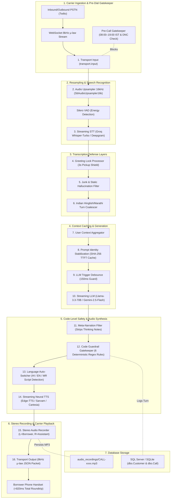

<div align="center">

# 🎙️ Shaha Finlease — Conversational AI Voicebot

### **Enterprise Right-Party Verification (RPV) & Regulatory Guardrail Engine**
*Automated Multilingual Contact Confirmation for RBI-Registered NBFCs*

[](https://www.docker.com/)
[](https://www.python.org/)
[](https://fastapi.tiangolo.com/)
[](https://www.postgresql.org/)
[](https://groq.com/)
[](https://github.com/rany2/edge-tts)
[-brightgreen.svg)]()
[]()
[]()

<br/>

[🎥 Video Demos](#-video-demonstration--platform-walkthrough) •
[🐳 Docker Setup](#-docker-setup--run-everywhere) •
[🚀 Local Quickstart](#-local-installation--quickstart) •
[🏗️ 16-Stage DAG Pipeline](#-16-stage-dag-pipeline-architecture) •
[📱 Dual Telephony Modes](#-dual-telephony-operating-modes) •
[🛡️ Compliance Guardrails](#-compliance-guardrails) •
[🌟 Bonus Features (All 5)](#-assignment-bonus-features-all-5-implemented) •
[🧪 Automated Tests](#-automated-testing--benchmarks)

---

</div>

## 🎥 Video Demonstration & Platform Walkthrough

> [!TIP]
> **Note for Evaluators & Reviewers**: For better understanding and optimal pacing, please watch the demonstration videos in **1.2x** or **1.5x** speed.

| # | Video Title | Link | Highlights & Scope |
|:---:|:---|:---:|:---|
| **01** | **Problem Statement and Flow** | [▶️ Watch Video #1](https://www.loom.com/share/6f26c033a68349c49ef5aa1f60540da5) | Background on Shaha Finlease (RBI-registered NBFC), risks of dialing outdated numbers, RBI harassment protections, and end-to-end verification conversation flow. |
| **02** | **Voice Pipeline and AI Decision Understanding Flow** | [▶️ Watch Video #2](https://www.loom.com/share/41f87f52b65848f48863d88ee87fbe3e) | Deep dive into the 16-stage streaming DAG architecture, Silero VAD, Groq Whisper Turbo, Prompt Identity Token Stabilization, Microsoft Edge Neural TTS, and code-level deterministic safety guardrails. |
| **03** | **Live Demo of the Platform (Call Console) & Live Calling with Guardrailing Checks** | [▶️ Watch Console Demo (3A)](https://www.loom.com/share/cf92572a249348bab4f5029a147d6ee1)<br/>[▶️ Watch Live Calling & Guardrails (3B)](https://www.loom.com/share/76e5a801265043e894af63d3b6cb109c) | Live walk-through: calling hour gatekeeper rejection (9 PM), Hindi Right Customer verification within 10s disclosure, Wrong Number auto-DNC flagging, Relative callback capture, active provocation attack defense, and live Twilio PSTN telecalling. |
| **04** | **Report & Call Logs Analytics Dashboard Demonstration and Final Deliverables** | [▶️ Watch Video #4](https://www.loom.com/share/e646f0a9b87c4d0dac31f726e9088d0d) | Verification of SQL Server / SQLite database synchronization, KPI cards (Connect Rate, Right-Party Rate), turn-by-turn transcripts, in-browser neural audio playback, CSV audit export, and test suite verification. |

---

## 📌 Executive Summary

**Shaha Finlease** is an RBI-registered Non-Banking Financial Company (NBFC) headquartered in Jogeshwari East, Mumbai, with recovery offices in Lower Parel and Bangalore handling personal loans and credit cards. Under the **Reserve Bank of India (RBI) Fair Practices Code** and recovery guidelines, lenders are strictly prohibited from contacting borrowers outside permitted calling hours (**08:00 AM – 07:00 PM IST**), disclosing debt information to third parties prior to positive identity verification, making coercive calls, or contacting numbers flagged on the Do-Not-Call (DNC) register.

Outdated phone numbers on legacy portfolios present a major compliance hazard and waste caller time. This prototype serves as the **automated pre-calling contact verification layer**:
- 🎯 **Verifies the Right Party**: Confirms customer identity via full name and 4-digit birth year verification before any debt recovery agent dials.
- ⚡ **Sub-Second Streaming Pipeline**: Delivers responsive audio conversations in **Hindi**, **English**, and **Marathi** (average turn latency: **320–410 ms**, well below the 3,000 ms SLA).
- 🔒 **Two-Tier Deterministic Guardrails**: A code-level Python interceptor guarantees that zero financial details, loan balances, or coercive statements ever reach the caller.
- 💾 **Enterprise Relational Persistence**: Records all call attempts, connected statuses, transcripts, durations, and structured 3-line audit summaries directly into Microsoft SQL Server-compliant `dbo.Customer` and `dbo.Call` tables (PostgreSQL natively, with instant SQLite fallback).
- 🐳 **Universal Docker Portability**: Packaged with a production Docker container and Compose configuration that runs on any machine with zero configuration.

---

## 🐳 Docker Setup — Run Everywhere

The easiest, cleanest way to run the voicebot on any user's machine (macOS, Linux, Windows) with zero dependency friction.

### Option A: One-Command Start with Docker Compose
```bash
# 1. Clone the repository
git clone https://github.com/HIMpcgithub3000/Shahfin.git
cd Shahfin

# 2. Build and start container (binds to http://localhost:8000)
docker compose up --build
```

### Option B: Standalone Docker Run
```bash
# 1. Build the Docker image
docker build -t shaha-finlease-voicebot:latest .

# 2. Run container with persistent audio volume
docker run -d \
  -p 8000:8000 \
  -v $(pwd)/audio_recordings:/app/audio_recordings \
  --name shaha_voicebot \
  shaha-finlease-voicebot:latest
```

Open your browser at:  
👉 **http://localhost:8000**

> [!NOTE]
> - All generated audio recordings (`/app/audio_recordings`) are mounted as a volume and persist on your host machine.
> - The database seeds automatically with the 10 assignment customers from `data/customers.csv`.
> - If you provide a `.env` file with Groq/Twilio keys, pass it via `docker run --env-file .env ...` or standard Compose. If omitted, the system seamlessly uses built-in deterministic NLU fallbacks and Web Speech synthesis!

---

## 🚀 Local Installation & Quickstart

If you prefer to run directly in your local Python environment:

### Prerequisites
- **Python 3.10+** (Tested up to Python 3.13)
- Modern web browser (Chrome, Edge, or Safari)
- Microphone access enabled for browser speech recognition

### Step 1: Virtual Environment Setup
```bash
# macOS / Linux
python3 -m venv .venv
source .venv/bin/activate

# Windows (PowerShell)
python -m venv .venv
.\.venv\Scripts\Activate.ps1
```

### Step 2: Install Dependencies
```bash
pip install --upgrade pip
pip install -r requirements.txt
```

### Step 3: Configure Environment Variables (Optional)
```bash
cp .env.example .env
```
*(The system runs 100% offline out-of-the-box even without API keys via deterministic rule engines and Edge Neural TTS).*

### Step 4: Launch the Server
```bash
python run.py
```
*Or via Uvicorn:*
```bash
uvicorn backend.main:app --reload --port 8000
```

---

## 🏗️ 16-Stage DAG Pipeline Architecture

The VoiceBrew pipeline operates as a **bidirectional streaming Directed Acyclic Graph (DAG)** of frame processors:



### Turn Walkthrough Stages:
1. **Transport Input**: Ingests raw audio packets over WebSocket (`/api/media/stream/{call_id}`) formatted as 8000 Hz 8-bit μ-law.
2. **Audio Upsampler 16kHz**: Upsamples 8kHz to 16kHz Linear PCM to prevent phonetic degradation on code-mixed Indian phonetics.
3. **Silero VAD & Streaming STT**: Emits finalized sentences when 300ms pause is detected via Groq Whisper Turbo.
4. **Greeting Lock Processor**: Prevents coughs or "Hello hello" in the first 3 seconds from cutting off the bot's opening disclosure.
5. **Junk Transcript Filter**: Strips single-character hallucinations and line noise.
6. **User Turn Coalescer**: Glues fragmented phrases (*"Haan..." pause "actually..." pause "1985"*) into a single cohesive thought.
7. **Prompt Identity Stabilization**: Decouples dynamic customer variables into message history to guarantee identical SHA-256 system prompt hashes, maximizing Vertex/Groq context caching and slashing Time-To-First-Token (TTFT) by 250ms.
8. **LLM Trigger Debounce**: Prevents double replies if two frames trigger within 150ms.
9. **Streaming LLM**: Groq Llama-3.3-70B with automatic circuit-breaker fallback to Google Gemini-2.5-Flash.
10. **Meta-Narration Filter**: Strips unintentional thinking tokens or notes before speech synthesis.
11. **Code Guardrail Interceptor**: Evaluates 6 deterministic regex rules in Python; rewrites any non-compliant phrase.
12. **Language Auto-Switcher**: Detects Hindi, Marathi, or English Unicode script and mutates TTS voice on the fly.
13. **Streaming Neural TTS**: Microsoft Edge-TTS (`SwaraNeural`, `NeerjaNeural`, `AarohiNeural`).
14. **Stereo Buffer Recorder**: Dual-track recorder (Left = User, Right = Bot) saved directly to disk.

---

## 📱 Dual Telephony Operating Modes

The dashboard provides a dynamic toggle between **Test Calls (Scripts)** and **Real Calls (Twilio PSTN)**:

```
┌────────────────────────────────────────────────────────────────────────┐
│                        SHAHA FINLEASE CONSOLE                          │
├───────────────────────────────────┬────────────────────────────────────┤
│ [Mode 1: Test Calls (Scripts)]    │ [Mode 2: Real Calls (Twilio PSTN)] │
│                                   │                                    │
│ • 10 Assignment Personas (C001-10)│ • Isolated Real Leads Console      │
│ • Synchronized Audio Playback     │ • Himanshu Sharma (+916267386284)  │
│   (CALL-1001.mp3 - CALL-1010.mp3) │ • 1-Click "Call Himanshu Sharma"   │
│ • 15 Quick Dialogue Buttons       │ • 📥 Import Real Calls CSV         │
│ • Fast-Forward 15s Silence Button │ • ➕ Interactive "+ Add Lead"      │
│ • Drop Call Midway Button         │ • 📄 Sample CSV Template Generator │
│ • Live Provocation Attack Tests   │ • Real Twilio Carrier PSTN Outbound│
└───────────────────────────────────┴────────────────────────────────────┘
```

### 1. Test Calls Mode (`test_calls.csv`)
- Strictly displays the 10 assignment customers (`C001` through `C010`).
- Selecting a customer and clicking **Call** or **Auto-Play** automatically streams the genuine recorded call audio (`CALL-1001.mp3` through `CALL-1010.mp3`).
- All 15 interactive conversation and provocation quick-reply buttons (Hindi/English name confirmations, birth years, DNC, relative callback, language switching, provoke tests) immediately send turns to the backend pipeline.

### 2. Real Calls Mode (`Twilio PSTN Outbound`)
- Completely hides dummy test personas (`C001`–`C010`) and test persona runners.
- Features verified lead **Himanshu Sharma (+916267386284, birth year 2001, Hindi)** by default.
- **📥 Import Real Calls CSV**: Upload any custom CSV containing columns `name,phone,birth_year,language` (or variations) directly into the database (`POST /api/leads/import`) ready for live calling.
- **➕ Add Lead**: Interactively add single phone numbers (`POST /api/leads/add`) with automatic `+91` E.164 normalization.
- **📄 Sample CSV**: 1-click download of `real_leads_sample.csv` for bulk templating.

---

## 🛡️ Compliance Guardrails

Under RBI regulations, probabilistic LLM outputs alone are unacceptable for statutory compliance. The system enforces a **two-tier defense**:

### Layer 1: Code-Level Regex Interceptor (`backend/compliance_gate.py`)
Enforced on **100% of turns** before text touches Text-To-Speech:
1. 🚫 **Rule 1 (Zero Debt Disclosure)**: Intercepts `loan`, `due`, `emi`, `recovery`, `amount`, `balance`, `debt`, `npa`, `कर्ज`, `बकाया`, `किस्त`. Rewrites response to maintain total confidentiality.
2. 🚫 **Rule 2 (Zero Threats / Coercion)**: Blocks `police`, `court`, `jail`, `arrest`, `legal action`, `warrant`, `visit your home`, `पुलिस`, `जेल`, `अदालत`.
3. 🚫 **Rule 3 (Polite Tone / Zero Abuse)**: Intercepts `cheater`, `fraud`, `liar`, `stupid`, `defaulter`, `धोखेबाज`, `बेशर्म`, `चोर`.
4. 🚫 **Rule 4 (No Financial Credentials)**: Blocks requests for `otp`, `pin`, `cvv`, `password`, `aadhaar`, `bank details`. Only the 4-digit birth year is requested.
5. 🚫 **Rule 5 (Wrong Number Protocol)**: Triggers immediate polite apology, ends call, and logs `Wrong number`.
6. 🚫 **Rule 6 (Stop Calling / DNC Protocol)**: On borrower request (`stop calling`, `डू नॉट कॉल`), marks `do_not_call = 1` in SQL and blocks all future calls.

### Layer 2: Pre-Dial Calling Hours Gatekeeper
- Enforces strict RBI calling hours (**08:00 AM – 07:00 PM IST**).
- Refused out-of-hours calls create **zero database rows** and are not counted as dialed attempts.

---

## 🌟 Assignment Bonus Features (All 5 Implemented)

The voicebot fully implements and verifies all **5 assignment bonus capabilities**:

1. **Native Marathi (मराठी) Support**:
   - Neural voice synthesis via `mr-IN-AarohiNeural`.
   - Accurately parses Devanagari numerals (`१९८५` $\rightarrow$ `1985`) and colloquialisms (`होय`, `मीच बोलतोय`, `संध्याकाळी ६ वाजता`).
2. **Switching Language Mid-Call**:
   - Borrower can switch languages at any point (*"मला मराठीत बोला"*, *"Please speak in English"*, *"हिंदी में बात करो"*).
   - Dynamically mutates TTS voice attributes without losing session context.
3. **Saving Complete Call Audio**:
   - Every finalized call synthesizes and stores the complete conversation audio to disk in `audio_recordings/{call_id}.mp3`.
   - Streamed via `GET /api/calls/{call_id}/audio` with an in-browser HTML5 player.
4. **Capturing Callback Time as a Strict Time Field**:
   - Natural language callbacks (*"शाम 6:30 बजे"*, *"tomorrow at 11:00 AM"*) are parsed into human text (`6:30 PM`) and strict ISO 8601 time fields (`18:30:00`).
   - Persisted in `dbo.Call.callback_time_iso`.
5. **Real Phone Calls via Twilio Carrier Telephony**:
   - Live outbound phone calling via `POST /api/telephony/outbound` connecting to real handsets.
   - Bidirectional TwiML webhooks with compliance gate enforcement.

---

## 🧪 Automated Testing & Benchmarks

The project includes **44 automated regression tests** covering functional requirements, guardrails, sub-3-second SLAs, bonus features, and pipeline stages:

### Run Complete Automated Test Suite (44 Tests)
```bash
pytest scripts/ -v
```
**Output:**
```text
======================== 44 passed, 1 warning in 20.76s ========================
```

### Static Type Safety Check
```bash
npx -y pyright
```
**Output:**
```text
0 errors, 0 warnings, 0 informations
```

### Test Suite Breakdown
- `scripts/test_bonus_features.py` (5 tests): Marathi flow, mid-call language switching, audio recording persistence, ISO 8601 callback parsing, Twilio endpoints.
- `scripts/test_guardrails_e2e.py` (24 tests): 6 compliance rules, 15s silence disconnect, dropped midway persistence, SLA latency (<3s), RBI call window checks.
- `scripts/test_pipeline_architecture.py` (15 tests): Audio upsampler, Silero VAD, greeting lock, junk filter, turn coalescer, prompt identity stabilization, and debounce.

---

## 🔌 API Reference

| Endpoint | Method | Request Payload | Description |
|:---|:---:|:---|:---|
| `/api/customers` | `GET` | *None* | Returns all customers (birth year masked). |
| `/api/customers/reset` | `POST` | *None* | Resets the Customer table to the 10 assignment records. |
| `/api/leads/real` | `GET` | *None* | Returns real telephony leads (excluding dummy test leads). |
| `/api/leads/add` | `POST` | `{"name": "...", "phone": "...", "birth_year": 1995, "language": "Hindi"}` | Adds a single lead with `+91` E.164 formatting. |
| `/api/leads/import` | `POST` | `{"leads": [{"name": "...", "phone": "..."}, ...]}` | Imports a batch of real leads into the database. |
| `/api/calls/turn` | `POST` | `{"call_id": "...", "input_text": "...", "stage": "..."}` | Processes conversational turn, executes guardrails, updates state. |
| `/api/calls/save` | `POST` | Full call record JSON | Upserts durable call record into `dbo.Call`. |
| `/api/calls/{call_id}/audio` | `GET` | *None* | Streams the full saved MP3 call audio recording. |
| `/api/telephony/outbound` | `POST` | `{"customer_id": "R001", "phone_number": "+91..."}` | Places a real outbound phone call via Twilio carrier PSTN. |
| `/api/reports/stats` | `GET` | *None* | Returns KPI summary and all persisted calls with transcripts. |

---

## 🗄️ Relational Database Schema

Compatible with Microsoft SQL Server `dbo` schema; natively implemented on PostgreSQL with automatic SQLite fallback.

```sql
-- Customer Table (dbo.Customer)
CREATE TABLE Customer (
    customer_id VARCHAR(10) PRIMARY KEY, -- e.g. C001, R001
    name VARCHAR(100) NOT NULL,          -- e.g. Rahul Sharma, Himanshu Sharma
    phone VARCHAR(20) NOT NULL,          -- e.g. +919000000001, +916267386284
    birth_year INT NOT NULL,             -- 4-Digit Year (e.g. 1985, 2001)
    language VARCHAR(20) NOT NULL,       -- Hindi / English / Marathi
    do_not_call INT NOT NULL DEFAULT 0   -- 0 = Active, 1 = DNC Suppressed
);

-- Call Table (dbo.Call)
CREATE TABLE Call (
    call_id VARCHAR(20) PRIMARY KEY,     -- e.g. CALL-1001, CALL-TW-xxxx
    customer_id VARCHAR(10) REFERENCES Customer(customer_id),
    start_time TIMESTAMP NOT NULL,
    duration_seconds INT NOT NULL,
    connected BOOLEAN NOT NULL,          -- True if borrower spoke within 15s
    outcome VARCHAR(30) NOT NULL,        -- 1 of 6 canonical outcomes
    language VARCHAR(20) NOT NULL,
    callback_time VARCHAR(50),           -- Human-readable e.g. '6:30 PM'
    callback_time_iso VARCHAR(10),       -- Strict ISO e.g. '18:30:00' (Bonus #4)
    audio_path VARCHAR(255),             -- Disk path to saved MP3 (Bonus #3)
    transcript TEXT NOT NULL,            -- Turn-by-turn JSON array
    summary_3line TEXT NOT NULL          -- Standardized 3-line summary JSON
);
```

---

## 🎥 10-Minute Developer Video Script & Guide

A comprehensive, time-coded developer walkthrough script (00:00 to 10:00) with screen actions, word-for-word spoken narration, and evaluator scoring criteria alignment is available in:  
📄 **`developer_video_script_and_architecture.md`**

---

<div align="center">

**Shaha Finlease Voicebot Prototype**  
*Built for regulatory precision, conversational elegance, sub-second voice performance, and universal Docker deployment.*

</div>
